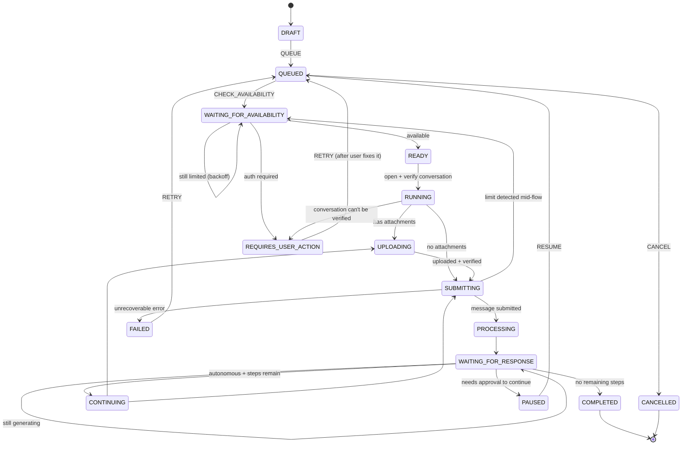
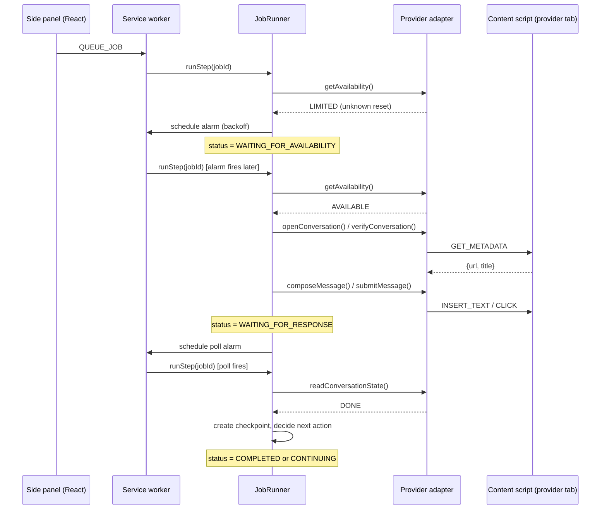

# Architecture

AI Flow is a Manifest V3 browser extension built as:

```
Browser Extension
  + Job Queue
  + Scheduler
  + State Machine
  + Provider Adapter
  + File Manager
  + Checkpoint System
  + Retry Engine
  + Security Layer
```

Nothing more exotic than that. This document explains how those pieces fit
together and why.

## Extension surfaces

| Surface | File | Responsibility |
|---|---|---|
| Service worker | `src/background/service-worker.ts` | Owns all state. Routes messages, runs the scheduler, drives jobs forward, fires notifications. |
| Content script | `src/content/content-script.ts` | Injected on demand into a provider tab. Reads visible DOM text and interacts with standard form elements (type into a box, click a button). Never runs standing/always-on. |
| Side panel | `src/sidepanel` | The main dashboard: overview, job lists, job details, settings, providers, security, logs. |
| Popup | `src/popup` | A tiny status summary + a button to open the side panel. |
| Options page | `src/options` | Settings / providers / security, for users who prefer the full-tab `chrome://extensions` options flow. |

The UI surfaces never touch storage directly. They send a typed
`UiRequest` (see `src/core/messaging/protocol.ts`) to the service worker via
`chrome.runtime.sendMessage` and get back a `UiResponse`. This keeps all
business logic in one place and makes the UI a thin, swappable layer.

## Core engines (`src/core`)

These are provider-agnostic, framework-agnostic, and unit-testable without
any Chrome APIs:

- **`jobs/job.model.ts`** — the `Job` type, `JobStatus`, `ExecutionMode`,
  `JobPriority`, and the `createJob()` factory.
- **`state-machine/job-state-machine.ts`** — the single source of truth for
  which status transitions are legal. Every status change in the codebase
  goes through `nextStatus(from, event)`; there are no parallel boolean
  flags that could drift out of sync with `status`.
- **`retry/retry-engine.ts`** — turns an error category into a retry
  decision (retry with backoff / require user action / fail outright).
  Different error categories get different policies on purpose.
- **`availability/availability-engine.ts`** — turns a provider's reported
  availability into a scheduling decision. Never fabricates a reset time;
  falls back to exponential backoff with an honest "unknown, checking
  again later" message.
- **`checkpoint/`** — an append-only log of `Checkpoint` records per job.
- **`prompt-engine/prompt-composer.ts`** — builds the structured
  continuation prompt (`CURRENT OBJECTIVE` / `CURRENT STATE` / `COMPLETED
  WORK` / `REMAINING WORK` / ... / `DO NOT DUPLICATE COMPLETED WORK`).
- **`scheduler/`** — a thin, dependency-injected wrapper around
  `chrome.alarms` (`AlarmsPort`), plus `Scheduler`, which schedules
  per-job wake-ups and a periodic queue-processing tick.
- **`storage/`** — `KeyValueStore` abstraction over `chrome.storage.local`
  (`JobStore`, `SettingsStore`), plus `AttachmentStore` over IndexedDB for
  file contents, plus `export-import.ts`.
- **`jobs/job-manager.ts`** — the only place allowed to mutate a job's
  status; wraps every mutation with the state machine.
- **`jobs/job-runner.ts`** — the execution engine. Given a job, drives it
  forward one status at a time by calling the provider adapter, creating
  checkpoints, and deciding what happens next (retry, wait, continue,
  pause for approval, complete, fail).
- **`jobs/loop-protection.ts`** — duplicate-submission fingerprints,
  `MAX_CONTINUATIONS`, and `MAX_EXECUTION_TIME_MS` guards.

## Providers (`src/providers`)

```
interface/types.ts        the AIProviderAdapter contract
interface/dom-provider-base.ts   shared DOM-interaction plumbing
mock/mock-provider.ts     MockAIProvider (fully simulated, used in tests/demos)
claude/, chatgpt/, gemini/   thin per-provider selector configs
provider-registry.ts      looks adapters up by id/domain
```

Core logic (the job runner, the UI) only ever depends on the
`AIProviderAdapter` interface. Adding a provider means writing a new
adapter and registering it; it never requires touching the scheduler,
retry engine, or state machine. See `docs/provider-adapters.md` for how a
DOM-based adapter actually works and its limitations.

## Job lifecycle



The full transition table (every legal `(status, event) -> status` triple)
lives in `src/core/state-machine/job-state-machine.ts` and is exercised by
`tests/unit/state-machine.test.ts`.

## End-to-end request flow



## Persistence and restart recovery

- Job metadata, checkpoints, and settings live in `chrome.storage.local`.
- Attachment file contents live in IndexedDB (`src/core/storage/attachment-store.ts`).
- On `chrome.runtime.onInstalled` / `onStartup`, `reconcileOnStartup()`
  (`src/background/reconciliation.ts`) restores the queue-tick alarm and
  resumes any job that's mid-flight but has no pending alarm (most likely
  because the service worker was killed between steps). Because every step
  persists its progress before yielding (tab id, attachment upload status,
  the last submitted prompt's fingerprint), resuming never repeats
  already-completed work.

## Why not more infrastructure?

No Kubernetes, no message queue service, no database server, no ML
pipeline. A browser extension's own primitives (`chrome.storage`,
`chrome.alarms`, IndexedDB) are enough to build a reliable local job queue,
and keeping it this way means the whole system fits in a viva-length
explanation.
